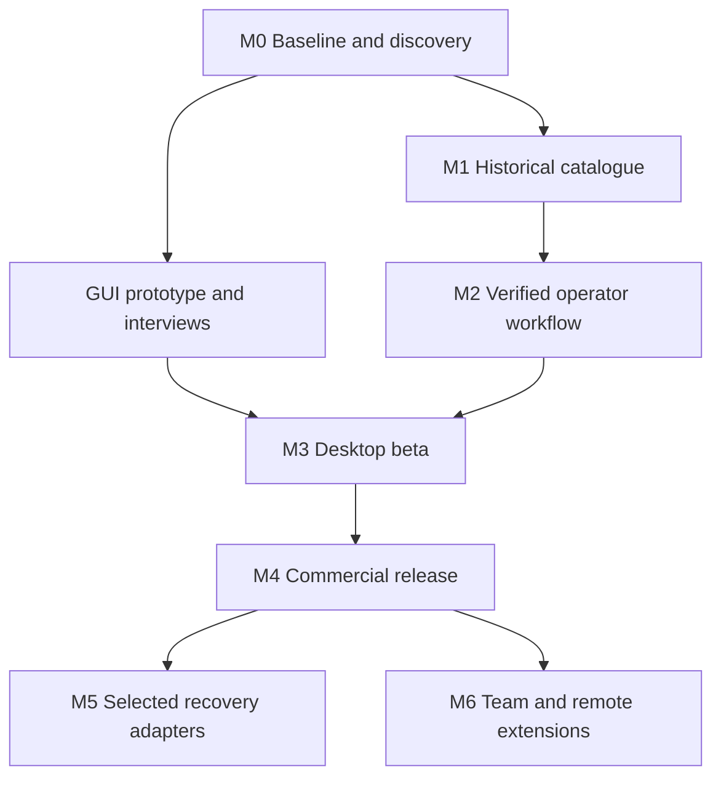

# NIGHTINDEX roadmap to commercialisation

**Date:** 24 November 2026. **Status:** proposed, gate-driven roadmap. The dossier and source inspection are complete planning inputs; implementation, runtime qualification and customer validation remain work to perform. No release date, customer demand or revenue is established by this document.

The intended product is a local media catalogue and reconciliation workbench that remembers what existed, explains what copies have been located, and preserves an honest account of unresolved files. The first commercial desktop release includes a usable GUI. A bounded service can validate the workflow earlier with an operator using the CLI.

Read the [commercial dossier](COMMERCIALISATION.md), [product specification](docs/commercialisation/PRODUCT_SPEC.md), [32-feature register](docs/commercialisation/FEATURES.md), [source baseline](docs/commercialisation/BASELINE_AND_SOURCES.md) and [validation plan](docs/commercialisation/VALIDATION.md).

## Sequence and decision gates

| Phase | Outcome | Prerequisites | Exit decision |
| --- | --- | --- | --- |
| M0 | Reproducible baseline, precise claims, bounded first buyer/workload | Existing source and this dossier | Is there a supportable initial problem and a reliable starting point? |
| M1 | Persistent historical catalogue and truthful loss account | M0 evidence contract | Can the system explain an old file's state despite missing media and incomplete scans? |
| M2 | Verified reconciliation workflow and bounded operator pilots | M1 plus execution safety | Can an operator deliver a useful paid result with measurable cost and repeatable evidence? |
| M3 | Usable desktop beta for the selected audience | M1/M2 engine contracts; early GUI prototype | Can a second operator complete the workflow independently on supported systems? |
| M4 | Supported commercial desktop release | M2 paid validation and M3 qualification | Can it be sold, installed, upgraded and supported without overstated claims or trapping customer catalogues? |
| M5 | Selected imaging, metadata and recovery integrations | Stable catalogue/coverage contracts and a funded customer need | Does each adapter earn its own version/layout support claim? |
| M6 | Selected technician/team/remote extensions | Repeated demand and viable support economics | Does the added deployment complexity pay for itself? |

M5 and M6 are optional expansion branches, not prerequisites for M4. Their order can change with customer evidence. GUI research and commercial interviews can run alongside M1; production execution must wait for stable evidence and identity contracts.

## M0 — establish the baseline and first scope

**Accountable role:** product owner with engineering validation. One person may hold both roles; independent usability and fault review still need another operator.

1. Preserve the pinned source baseline and reproduce the existing local build/test/release script on an actual supported host. Record toolchain, dependencies, command outputs and the source revision. Resolve the difference between historical test counts and the static inventory. Do not report a README claim as a fresh test run.
2. Correct or qualify capability language around archive interiors, heuristic “identical” scores, hash cache reuse, copied versus verified bytes, and filesystem metadata preservation. The [baseline](docs/commercialisation/BASELINE_AND_SOURCES.md) explains the source evidence.
3. Decide the initial support envelope: a named Linux distribution/release and architecture, a small set of mounted filesystems, regular files/symlinks as tested, local catalogue storage, and a stated preservation policy. An initial Debian/KDE target is a hypothesis suited to the existing operating context, not proof of commercial demand or cross-platform support.
4. Write synthetic ground-truth cases before implementing the new evidence model: a deleted file, renamed same bytes, changed version, offline disk, incomplete scan, excluded subtree, stale cached digest and a later rediscovered copy.
5. Run 6–10 discovery interviews across two plausible cohorts. Use actual recent cases and existing purchases; distinguish interest from willingness to buy. Record decisions without putting customer information in the public repository.
6. Prototype the GUI's search/history, media list and conflict review with synthetic data. Compare feasible frameworks and integration approaches through the same tasks. Record the choice and licence implications before large UI investment.
7. Resolve ownership and release boundaries. The inspected repository is public and contains no root licence file; this roadmap does not choose a licence, change visibility or grant distribution rights. Inventory dependencies before commercial distribution.

**Exit evidence:** reproducible baseline results, a chosen support envelope, approved product vocabulary, representative fixtures, interview findings and a bounded first offer. If interviews only reveal a generic catalogue need already served adequately, narrow the offer before adding more features.

## M1 — preserve historical knowledge

**Primary features:** F01–F06, F09, F22, F23 and F25. **Parallel work:** F14 prototype and F32 schema design.

Build the smallest durable catalogue that can answer the core historical questions. Keep SQLite and the existing CLI unless measurements establish a specific reason to change them.

| Work package | Deliverable | Acceptance evidence |
| --- | --- | --- |
| Catalogue schema and migrations | Case/media/source IDs; scan generations; immutable observations; coverage; typed digests; content occurrences; loss leads | Migration and restoration preserve evidence; current views do not overwrite earlier observations. |
| Legacy import | Import existing databases and generic manifests with original artifact hashes and provenance | Mixed old rows remain observations of limited/unknown completeness. The importer never invents a completed historical scan or original hash-read time. |
| Scan lifecycle | Bounded transactional batches; explicit run state; durable error/exclusion records; completed generation publication | Kill/unplug/permission failures leave prior complete state available and the new generation visibly partial. |
| Search and loss account | Offline lookup, history, last-seen media/path, alternatives, unresolved sources and explanatory status | The synthetic lost-file case remains searchable after removing the original disk; a later exact copy resolves the lead without erasing history. |
| Catalogue survival | Consistent backups, portable export and restore on a clean machine | Restored case retains observations, evidence links and unresolved leads without original media or a network service. |

**Exit gate:** all truth-model fixtures pass, including zero false “never existed”, “verified today” and “permanently lost” conclusions in the defined corpus. Export/read access works offline. Performance is measured against declared record counts and hardware. M1 may be useful for an internal read-only service; it does not qualify copy/recovery claims.

## M2 — trustworthy reconciliation and paid operator pilots

**Primary features:** F07–F08 basic slices, F10–F13, F21, F24, F27, F29 capacity and F32 local protocol.

Unify the current copy/merge execution paths behind a common job contract. Preserve the useful comparison and planning code, but make exact content, candidate similarity and verification outcomes explicit.

Required engineering outcomes:

- Plans pin source/destination identities, scan generations, selected objects, policies and preconditions. The operator reviews intended writes and preservation exceptions.
- Copy completion and fresh verification are separate events. Source changes, destination corruption, disk-full conditions, disconnection and late filename conflicts cannot silently produce a verified result.
- No-overwrite behaviour uses an appropriately atomic platform operation where supported, or fails safely when the guarantee cannot be implemented. A check followed by ordinary rename is insufficient as the product contract.
- File and directory durability ordering is defined for each supported target. The product explains the limits of the selected durability mode.
- Resume/cancellation preserve partial work and evidence; reattachment revalidates identity. Unsupported preservation flags fail or require an explicit exception.
- Plans expose required capacity and retain divergent versions. Similarity does not authorise deleting the only known copy. All known-copy counts state scope and physical failure-domain assumptions.
- Reports include media, tool/policy versions, scans, coverage gaps, exact/candidate relationships, verification dates and unresolved leads. Another operator can trace each reported conclusion.

**Pilot offer:** a fixed-scope intake and reconciliation service for readable media or existing images. Sell the media map, searchable catalogue, verified/candidate relationships, exception register and portable handover. Quote specialist imaging or repair separately. A customer must not be sold functionality that is still a roadmap item.

**Commercial experiment:** recruit 3–5 bounded paid pilots after the relevant qualification gates. Track operator time separately from machine time, review cost per exception, direct expenses, support hours, actual collected price and willingness to repeat the purchase. Use the [dossier's](COMMERCIALISATION.md) pricing experiments rather than inventing a market rate.

**Exit gate:** at least three independently paid cases with repeatable bounded delivery, no unsupported claims in reviewed reports, demonstrable customer benefit and acceptable direct-labour/support economics under the owner's declared threshold. These counts are proposed decisions, not statistical proof of market fit. One independent operator reproduces a case and handover. If support consumes the margin, narrow the scope or price before expansion.

## M3 — desktop beta

**Primary features:** F14, F16 selected formats, F20 manual integrity review, F25 measured scale, F27 onboarding and F29 copy-location analysis. Add selected F09/F30 imports when pilots establish a need. F15 preview is optional and must not delay the essential workflow.

Deliver a coherent desktop application around the engine. Required screens are case overview, media shelf, search/history, reconciliation review, loss account, job monitoring and reports/catalogue care. The operator should see what the system knows, what it has not examined and what the next action will do.

Use the same versioned local job/event contract for GUI and CLI. Jobs survive the UI closing; progress is structured; cancellation is bounded. Keep privileged device work outside the GUI. All large views require pagination or virtualization and clear partial-result indicators.

Implement real archive listing only for a deliberately small initial format set. Preserve current filename/family comparisons as candidate evidence. Record member provenance, nesting/expansion limits, encrypted or truncated states and parser versions. Preview and import workers must be isolated and resource-limited.

**Exit gate:** a second operator completes the benchmark case without author intervention; keyboard/accessibility and interruption tasks pass; supported real fixtures meet declared latency/memory targets; malformed inputs do not escape their scope. Reports and UI give the same evidence conclusions. The supported platform/filesystem matrix is published with exceptions, not a generic “cross-platform” claim.

## M4 — supported commercial release

**Primary features:** the selected P0/P1 slices plus F20 scheduling, F23 complete deployment policy, F26–F28 distribution/support/entitlements. A previously deferred P1 slice may be excluded only by narrowing the documented offer and support matrix.

Prepare a release candidate with a manual, repeatable gate on clean supported hosts. Record the full source revision and fixture outputs, run the existing local checks with Clippy enforcement after resolving its debt, and test installers, updates, rollback, catalogue migrations and restoration. Package signing/checksums and a documented dependency inventory are release work. This roadmap adds no CI requirement.

Make these owner decisions concrete before taking desktop orders:

| Decision | Required evidence or artifact |
| --- | --- |
| Licence and commercial control | Ownership/contributor review, dependency/GUI/integration obligations, selected terms and permitted technician use. No automatic repository-visibility or source-licence change. |
| Price and packaging | Recorded comparable offers, actual acceptance/payment and support cost; explicit included updates/support, not a revenue forecast derived from interview enthusiasm. |
| Offline use and expiry | Activation policy if used; permanent reading/export of existing catalogues; offline interruption and expiry test. |
| Support promise | Named systems/formats, response and maintenance terms, diagnostic redaction, upgrade window and an escalation route for specialist recovery. |
| Data handling | Retention/export/deletion workflow, support-bundle consent and redaction, credential handling, catalogue backup and encryption/key-recovery policy. |
| Product claims | Traceability from every published capability to a tested fixture and supported version; no blanket recovery, complete-loss, certification or forensic-preservation claims. |

**Exit gate:** the selected [validation matrix](docs/commercialisation/VALIDATION.md) passes on the supported envelope; a clean installation and backup/restore/rollback drill succeed; independent usability and paid-pilot gates are met; licensing/support decisions are recorded. No known issue may invalidate the core truth model or compromise source data. Limitations that remain must constrain the advertised offer.

## M5 — imaging, surviving metadata and selected recovery

**Primary features:** F07 advanced topology, F08 device profiles, F17–F19. This is a sequence of separately scoped projects, not one checkbox called “RAID recovery”.

1. **Evidence import:** ingest image metadata, ddrescue maps and selected recovery-list exports; retain raw artifacts, version and provenance. Expose unacquired ranges and evidence gaps.
2. **Acquisition integration:** supervised imaging jobs with correct device binding, durable maps, explicit output targets, interruption/restart and health/read-budget controls. Validate on disposable fixtures.
3. **Topology recognition:** a tested selection of partition/array/ZFS metadata formats, observed member IDs, relationships and missing members. Recognition does not imply reconstruction.
4. **Metadata enumeration:** retrieve surviving names/objects where a supported parser can do so. Distinguish readable metadata, inferred paths and missing/locked metadata. Version-gate unstable tool output.
5. **Selected content reconstruction:** only pursue named layouts, filesystem versions and failure classes whose ground-truth corpus demonstrates useful recovery. Maintain offsets/extent maps and explain incomplete streams.

**Exit gate per adapter:** documented supported versions, malformed-input behaviour, read-only boundaries, acquisition/coverage semantics, independent ground-truth comparison and a costed paying use case. No whole-array recovery percentage can be inferred from one member or a filename list. A negative feasibility result is a valid output and should stop that investment.

## M6 — team and remote extensions

**Primary features:** F30–F32 plus any demand-led F15 enrichment or expanded platform support.

Validate one deployment model at a time: technician case handover; a local shared catalogue service; authenticated remote inventory agents; or selected cloud/backup connectors. Each adds authentication, permission, connection-loss, schema-version, retention and support obligations. Do not put a writable SQLite WAL database on a shared network filesystem as a shortcut to a multi-host product.

A cloud connector must preserve object versions, partial-listing/permission failures, offline/cold states and cost implications. A remote agent must attest to its source identity and scope without making inaccessible sources appear empty. Team review needs operator attribution and conflict resolution. Existing catalogues must remain readable if the service is unavailable.

**Exit gate:** customers explicitly buy the extension at a scope/price that covers its extra support; access separation and failure fixtures pass; migration and offline behaviour remain compatible with the catalogue-survival promise.

## First implementation backlog

These are proposed work packages, not issues already opened or code already changed. Convert them to repository issues only when beginning implementation, retaining feature IDs and acceptance evidence.

| Order | Work package | Feature IDs | Completion evidence |
| --- | --- | --- | --- |
| 1 | Reproduce current CLI baseline and qualify capability language | F25–F27 | Source/toolchain-pinned results and correct documentation. |
| 2 | Specify immutable observations, coverage, typed digests and migration | F01–F04, F09 | Reviewed schema and ground-truth fixtures; legacy uncertainty retained. |
| 3 | Implement transactional scan lifecycle and completed-generation views | F02, F04, F08 | Interrupted/excluded/error cases do not create false losses or fresh-verification claims. |
| 4 | Implement media/source identity and collision handling | F06–F07 | Clone, hidden-serial and reused-mountpoint fixtures pass. |
| 5 | Implement offline historical query and loss-lead resolution | F03–F05, F10 | A lost version can be found, explained, resolved and reopened with provenance. |
| 6 | Implement independent backup, export and restore | F22–F23 | Clean-machine restore retains all evidence; no source disk or online entitlement needed. |
| 7 | Extract shared jobs/execution contract from existing paths | F11–F13, F24, F32 | Copy and merge share preconditions, no-clobber, resume and result semantics. |
| 8 | Add verification and preservation evidence | F04, F11, F13 | Mutation/corruption/disk-full/metadata exceptions produce truthful results. |
| 9 | Deliver report and operator-pilot workflow | F21, F27, F29 | Independent handover and measured paid-case economics. |
| 10 | Complete GUI slice, bounded archive readers and beta | F14, F16, F25 | Independent usability, parser and large-result fixtures pass. |

Discovery, GUI design and fixture design should start immediately alongside steps 1–3. Do not defer design until every backend feature is built. Conversely, a polished mock-up does not close the data-integrity or commercial-validation gates.

## Scheduling and capacity

Use timeboxes for discovery and prototypes, and acceptance gates for product commitments. A suggested **first 30 working days**, contingent on available owner capacity, is:

- **Days 1–5:** reproduce baseline, choose the first support scope, prepare ground-truth cases and interview questions.
- **Days 6–15:** conduct discovery, review schema/migration design, prototype the core GUI tasks, and implement the smallest historical scan/query slice.
- **Days 16–30:** exercise interruption/identity/restore fixtures, demonstrate the synthetic loss-accounting workflow to prospective operators, and estimate the remaining M1/M2 work from measured progress.

This is a proposed work allocation, not a promise to finish M1 or launch within 30 days. At the M0 exit, estimate each remaining package using the chosen platform, GUI team, fixture corpus and weekly engineering capacity. Reserve time for design, support, data migration and fault fixing. Publish delivery ranges only after that sizing; advanced RAID work must have its own research budget and stop condition.

## Governance and evidence updates

Keep this roadmap and the feature register versioned with the source. For each completed requirement, record its implementation commit, supported environment, validation artifact and remaining limitations. For each reprioritisation, record the customer evidence or technical finding that changed the decision.

The product owner holds pricing, licence, distribution and scope decisions. Engineering owns evidence semantics, execution correctness and migrations. Design owns independent task usability. Validation owns the ground-truth corpus and review of claims. Support feedback changes priority only when it identifies a repeated need, a material correctness problem or a support cost that changes the economics.

Stop expanding when the current slice cannot be delivered reliably or profitably. Success at this stage is a durable, understandable account of a customer's files and a repeatable paid workflow—not the number of formats, algorithms or roadmap boxes accumulated.
