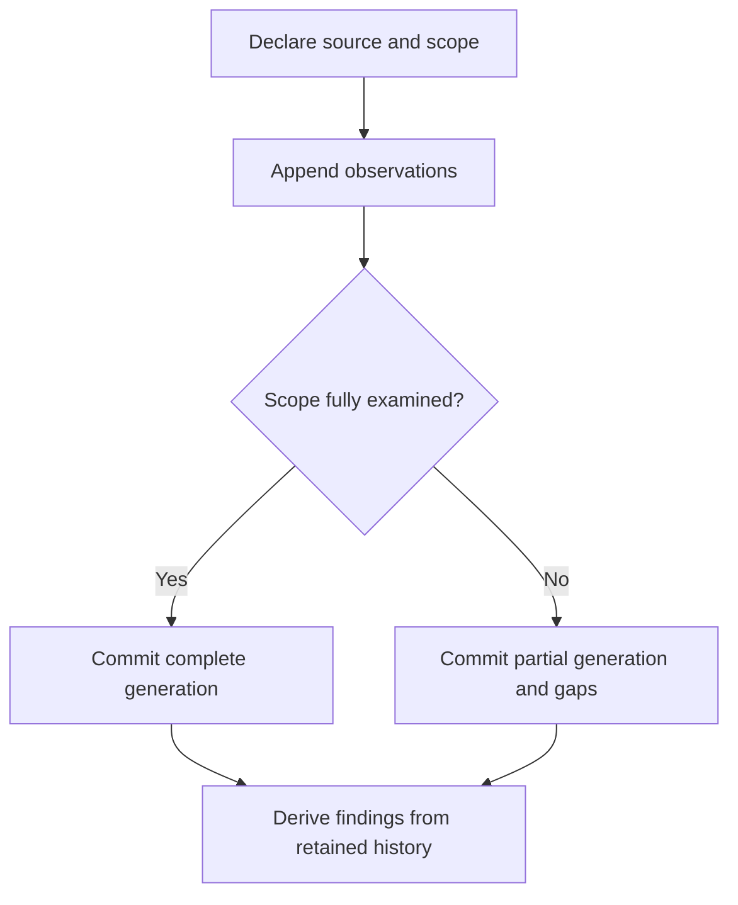

# NIGHTINDEX product specification

**Status: proposed product behaviour, 24 November 2026.** This document defines the intended commercial product. It does not describe released capabilities or completed validation. The inspected implementation and its limitations are recorded in [Baseline and sources](BASELINE_AND_SOURCES.md). Scope and ordering are governed by the [feature catalogue](FEATURES.md), [roadmap](../../ROADMAP.md) and [validation plan](VALIDATION.md). See the [commercialisation dossier](../../COMMERCIALISATION.md) for the commercial rationale.

## 1. The job the product must complete

NIGHTINDEX should reconcile scattered storage and preserve knowledge of what existed. The central question is: **“Did I have this file, where was it last seen, and is there a verified surviving copy?”** A useful answer remains possible when recovering the contents is impossible. It should prevent years of repeatedly searching for files whose disappearance has already been investigated.

Two workflows feed the same catalogue. Healthy media can be indexed before anything fails. After an incident, existing manifests, backup catalogues, recovery reports and surviving filesystem metadata can supply evidence. Neither workflow should require a universal recovery engine.

For a box of unfamiliar drives, the deliverable is a searchable media inventory, reconciled file versions, verified destination copies where possible, unresolved-file leads, sources still needed, and a record of examination coverage. Those answers remain available after the drives are disconnected or returned.

An illustrative answer, with synthetic names and dates, is:

> `research-notes.odt` was recorded on Archive-07 on 11 February 2024. That medium was subsequently reported failed. No matching full-content digest has been found in the sources examined by this case. Archive-12 contains a same-name candidate; two registered backups remain unexamined. Last verified contents: 11 February 2024.

When a newly supplied drive contains an exact verified match, append a resolution event. Retain the earlier source failure, searches and uncertainty: the later discovery must not rewrite history.

## 2. Evidence and state semantics

Four independent dimensions support conclusions. A single `lost / recovered` enum cannot represent them safely.

| Dimension | Proposed typed records or labels | Meaning |
|---|---|---|
| Existence evidence | `ObservedEntry`, `ImportedRecord`, `RecoveredMetadata`, `ReportedOnly` | How the historical occurrence became known, with source and observation provenance |
| Accessibility | `ReadableAtObservation`, `ReadError`, `Offline`, `UnavailableReported`, `NotChecked` | What was observed or reported about a particular occurrence/source at a particular time |
| Verification | `NotRead`, `SampledFingerprint`, `FullDigestRecorded`, `HistoricalBaselineMatch`, `CopyReadbackMatch`, `Mismatch` | Which content comparison occurred; algorithm, byte coverage and reference are required fields |
| Search coverage | `CompleteWithinScope`, `Partial`, `Excluded`, `Unsupported`, `NotExamined` | Which declared source and path scope was actually examined, including errors and omissions |

These labels are proposed API vocabulary. Several records can apply over time; a new observation never silently overwrites a contradictory older one. Acquisition coverage and file stability are additional verification attributes, not hidden assumptions inside “verified”.

`NoRecord` is a query result, not evidence that a file never existed. `ReadableAtObservation` is historical, not a promise of current availability. A reported destroyed disk remains an attributed report. “No verified surviving copy among this case's examined sources” is a bounded conclusion, with the saved source universe and gaps visible.

Loss-lead workflow states are separate: `Open`, `CandidateFound`, `ResolvedByVerifiedCopy`, `ClosedByOperator`, and `Reopened`. An operator can stop pursuing a lead without changing its evidence. A heuristic match cannot automatically resolve it. Case closure is reversible when new evidence appears.

Record `observed_at`, `imported_at` and filesystem timestamps separately, with origin, precision and known clock uncertainty. Cached hashes retain the original full-read verification time. A policy may say “reverification due”; it cannot erase the earlier verification or label the contents newly verified without reading them.

## 3. Conceptual records and observation lifecycle

The initial implementation should extend SQLite with versioned migrations, transactions and indexes. These are conceptual records, not separate services.

| Record | Required relationship and data |
|---|---|
| Case | Purpose, owner, declared sources/scope, decisions and export policy |
| Media asset | Internal ID, physical label/location, observed identifiers and condition history |
| Logical source | Partition, filesystem, dataset, share, image or container; relation to assets and other sources |
| Acquisition | Source/destination identity, tool/version, image/mapfile references, byte bounds and acquisition coverage |
| Scan generation | Source, declared scope, policies, consistency model, start/end, state, exclusions and errors |
| File occurrence | Lossless path representation, source, object identity where available, type/attributes and observation references |
| Content version | Algorithm-qualified full digest and size where known; unknown content remains representable |
| Evidence artifact | Original imported file, hash, origin, parser/version and interpretation record |
| Match relation | Exact content, candidate, possible rename, version difference, hardlink or archive-member relation, with reasons |
| Search/loss lead | Historical occurrence/content sought, examined sources, candidates, decisions and resolution events |
| Operation | Reviewed plan, policies, executed actions, failures, checkpoints and verification outputs |

Persist observations incrementally with a scan identity. Finalisation commits the scope's completion state and gaps; interrupted work cannot masquerade as complete.

A completed live traversal supports “not observed in this traversal.” A file can move from an unvisited directory into an already visited one and evade enumeration while existing throughout. Reserve stronger absence conclusions for a consistent snapshot or another explicitly justified observation of a stable scope. Permission errors, unsupported entries, cancellation, disconnected media and unreadable directories remain explicit gaps. Record snapshot identity when available; otherwise detect changing files where feasible and report the consistency limitation.

A full digest records the stream read. Claiming it represents a stable file version additionally requires an appropriate consistency contract. Pre/post metadata checks alone cannot rule out every concurrent modification, particularly when timestamps can be restored. Retain snapshot/stability evidence or an explicit consistency limitation alongside the digest.

### Migration from the inspected implementation

The baseline uses `(label, rel_path)` replacement; label loading can retain stale entries from earlier scans. Hashes can be reused when type, size and mtime match. Archive-member records are inferred from archive-like filesystem paths, without actual archive parsing. These findings constrain migration and claims; see [the pinned baseline](BASELINE_AND_SOURCES.md).

Import surviving legacy rows as legacy observations with unknown generation/completeness where the old format does not prove them. Preserve original values and import provenance. Do not fabricate overwritten versions, a complete snapshot, or a trustworthy “last seen” timestamp from an undifferentiated label. Introduce explicit generation and coverage records before deriving disappearance.

Keep cached digest reuse available as a performance policy, but distinguish “cached digest consistent with cheap metadata” from “bytes read and verified now”. Include changed same-size/same-mtime contents in validation. Existing archive-path inference remains a candidate relationship. Actual entry enumeration, member hashing, encryption handling and resource-limited parsing require new implementation and fixtures.

## 4. Identity, versions and physical media

A path describes location, not content identity. The same path can hold different versions; the same bytes can appear at multiple paths. Equal full digests under the same suitable algorithm and byte definition support byte identity, but both occurrences and their provenance remain. Filename, size, timestamp, partial fingerprint, binary similarity and semantic similarity identify candidates only.

Filesystem object identifiers are scoped to the filesystem and observation context; reuse must be handled. Hardlinks are linked occurrences, not independent backups. Preserve original filename bytes or another lossless platform representation plus safe display text. Record case sensitivity and normalisation assumptions. Cross-platform name collisions require a reviewed destination policy.

An archive member belongs to a specific container content version and parser result. Duplicate member names, encrypted entries, nested containers and failed parsing remain representable. Seeing a container name does not establish that its contents were enumerated. Content recovered by carving without original metadata can be useful without being assigned an invented original name/path.

Assign each physical asset an internal ID. Record model, serial, WWN, capacity, geometry, filesystem identifiers and pool/vdev GUIDs when available, with observation provenance. Device nodes, drive letters and mountpoints are transient access locations.

A bridge can hide identifiers; cloning can duplicate them. Reconnection should correlate attributes and require disambiguation when identity affects a consequential operation. A clone is a separate asset linked to its acquisition, even if it carries the original filesystem UUID. A new disk at an old mountpoint must never inherit the old disk's history or resume job automatically.

The media register should support labels/QR export, location and custodian, received/returned/failed/disposed events, and topology from disks through logical sources to file occurrences. Show image/clone lineage and missing array members. Health observations help triage but do not prove file integrity. Two copies on one physical disk are not two independent media copies; expose shared failure dependencies.

## 5. Scanning profiles and read budgets

Choose a profile by source condition and question. Metadata enumeration still reads media; it is not a universally safe first operation on a failing disk.

| Profile | Intended purpose | Explicit budget/control |
|---|---|---|
| Metadata inventory | Healthy mounted trees; fast historical coverage | Enumerated roots, attribute set, archive inspection off unless selected |
| Verified inventory | Healthy media or stable images | Full digest scope, concurrency, bandwidth and bytes/read errors |
| Candidate search | Large healthy collections | Metadata/fingerprint stages followed by selected full verification |
| Fragile-media intake | Suspected failing devices | Minimal identification; no automatic broad hashing, previews or recursive scan |
| Image analysis | Preserved images/working clones | Acquisition coverage, supported parsers, CPU/memory/time and nesting limits |

Every job needs pause/cancel, bounded retries, checkpoint visibility and separate successful/skipped/failed counts. Avoid percentage estimates with an unknown denominator. Record elapsed work and discovered totals honestly. A reconnect must revalidate source/destination identity before resume.

Hashing can be staged for cost, but no sampled stage becomes an exact match. Optional previews, content extraction and semantic indexing require explicit profiles because they increase reads and expose more private content. A prior catalogue remains searchable without touching its original media.

## 6. Reconciliation, copying and preservation

Present exact duplicates, candidate duplicates, conflicting versions and unique occurrences separately. Explain each match using recorded evidence. Folder similarity and archive overlap can guide review; they do not authorise automatic deletion or an assumption that all descendants match.

A reviewed copy plan must bind source/destination identities, source version expectations, collision policy and required preservation properties. Preflight capacity, unsupported names and metadata, destination capabilities and operations that could overwrite existing data. Safe initial behaviour should retain both conflicting versions unless the user explicitly chooses otherwise. Destructive deduplication is outside the initial commercial workflow.

Distinguish three outcomes:

- **Copy completed:** the engine reports writing the planned bytes.
- **Copy readback matched:** destination bytes were read and matched the reference captured for that operation.
- **Historical content preserved:** the result matched an appropriate historical baseline, with coverage and stability sufficient to support that conclusion.

Copying a damaged or incomplete representation successfully does not prove recovery of intact original contents. When an image contains unread/substituted regions, retain that coverage. Map those regions to affected files only where the supported filesystem/extent interpretation permits; compression and missing metadata can make impact unknown.

Content equality is separate from preservation of timestamps, permissions, ownership, ACLs, extended attributes, hardlinks, sparse regions or platform-specific streams. Expose supported properties and report losses. Existing compatibility flags and copy behaviour must be validated against these contracts before the GUI promises preservation; current command acceptance is insufficient evidence.

## 7. GUI screens and complete user flows

The GUI must let an operator finish the job without reconstructing CLI output. Keep detailed evidence available while using plain language for ordinary decisions.

| Screen | Decisions and evidence it must support |
|---|---|
| Case overview | Supplied sources, work completed, verified results, unresolved leads and next useful source |
| Media register | Physical labels/location, condition, topology, image lineage and reconnect guidance |
| Search everywhere | Current/historical/offline occurrences, versions, last seen, media and verification filters |
| File history | Dated observations, path changes, failures, candidate/verified copies and unresolved gaps |
| Reconciliation | Exact duplicates, candidates, folder/archive relationships, conflicts and manual decisions |
| Plan and execute | Destination checks, policies, resumable progress, errors and verification results |
| Loss ledger | Historical files without verified alternatives, priorities, prior searches and sources still required |
| Reports and exports | Customer summary, complete evidence, redaction options and portable catalogue |

**Healthy collection flow:** register media → select scope/profile → capture and verify as chosen → review differences → create destination plan → execute/readback → export catalogue and back it up independently.

**Incident flow:** register supplied media and its condition → import prior knowledge → acquire/import images where appropriate → enumerate supported evidence → reconcile recovered files → review remaining leads and source gaps → issue a bounded report.

**Months-later search flow:** search the historical catalogue → inspect last known occurrence/version → see examined and unexamined sources → reconnect a labelled source if useful → verify a candidate → append resolution or the new search result.

Require keyboard access, accessible status text, virtualised large tables, responsive background work, persistent filters and clear error recovery. Do not reduce incomplete results to one green percentage. A usability exercise should measure whether an operator can find a historical file, identify the right disk, verify a candidate and export a defensible conclusion.

Linux/KDE first is a product hypothesis to test against pilot users. Compare a bounded Qt/QML and Tauri prototype using the same search/table/background-job flow, packaging effort, accessibility and engine boundary. Qt has module-dependent licensing options; Tauri separates a privileged core from webview processes. Review those constraints from [Qt's licensing documentation](https://doc.qt.io/qt-6/licensing.html) and [Tauri's process model](https://v2.tauri.app/concept/process-model/). Neither toolkit is mandated by this dossier.

## 8. Catalogue durability, privacy and imports

The catalogue must survive loss of the disks it describes. Provide consistent backups to an independently selected location, artifact checksums, schema versions, restore verification and recovery of relationships as well as file rows. SQLite offers an [online backup API](https://www.sqlite.org/backup.html); copying an active database file without coordinating its state is not the product's backup design. Do not implement multiuser sharing by placing a live WAL database on a network filesystem: SQLite documents the [same-host requirement for WAL](https://www.sqlite.org/wal.html).

Export a documented JSONL/CSV representation plus a manifest of schema, scope, media, observations, versions, relationships and errors. Round-trip tests must preserve meaning. Historical search and data export should remain available if a commercial licence expires. Users must not lose access to their own catalogue because the product is discontinued.

Treat filenames, paths, thumbnails, hashes and customer/project labels as sensitive metadata. Default to local operation. Scope exports by case, preview redactions, avoid automatic external enrichment and provide understandable retention/deletion choices. Catalogue encryption and key recovery are design decisions to validate, not a reason to invent cryptography or make search data unrecoverable.

Importer order should begin with existing NIGHTINDEX manifests, then a versioned generic inventory format, hash/file lists, supported backup catalogues and recovery reports. Preserve original artifacts, parser version, timestamp transformations, skipped records and raw paths. The [Sleuth Kit `fls` manual](https://sleuthkit.org/sleuthkit/man/fls.html) documents image filename listing and some deleted entries, but recursive listing does not follow deleted directories. A bodyfile adapter must retain that coverage limitation.

Disk contents and imported reports are untrusted input. Run high-risk parsers with bounded memory, CPU, bytes, nesting and time; constrain filesystem access and network access. Avoid shell interpolation, archive traversal, unsafe deserialisation, active HTML previews and spreadsheet-formula execution in exports. Parser failure must produce an explicit partial result, not a complete inventory. Preserve source evidence while keeping executable attachments out of normal preview paths.

## 9. Acquisition and RAID/ZFS feasibility

Integrate established acquisition tooling rather than writing a new imaging engine. The [GNU ddrescue manual](https://www.gnu.org/software/ddrescue/manual/ddrescue_manual.html) documents mapfile-based resumption and advises working on copies of failing media. Record image, mapfile, source/destination identities, tool version, byte bounds and unread regions together. A completed image artifact or successful tool exit is not a file-integrity certificate.

The integration ladder is: import an existing acquisition/report → validate identity and coverage → display progress/mapfile state → offer controlled supported acquisition profiles → add image-analysis adapters. Privileged block access belongs in a narrow component; normal catalogue browsing does not require it. Repair on original media and aggressive recovery flags are outside the initial product scope.

The following is a **proposed qualification matrix**, not a support claim:

| Input condition | Intended useful result | Qualification boundary |
|---|---|---|
| Healthy mounted tree | Inventory, reconciliation, selected verification | Traversal and metadata-preservation fixtures on each declared platform |
| Existing manifest/catalogue | Historical existence and search leads | Versioned importer; completeness only if source proves it |
| Image with supported filesystem | Names/metadata and readable contents | Parser/version support, acquisition gaps and known-truth fixtures |
| Complete/degraded supported array | Topology plus data exposed by tested tooling | Exact layout, member identity, feature flags and keys where required |
| Partial array beyond redundancy | Surviving labels; best-effort metadata/content where demonstrable | No filename/full-path guarantee; report actual extracted coverage |
| Encrypted/unsupported source | Identity, locked/unsupported status and next dependency | No implied decryption or generic reconstruction capability |

OpenZFS documents [RAIDZ parity, failure states and special vdev roles](https://openzfs.github.io/openzfs-docs/man/v2.3/7/zpoolconcepts.7.html). Relevant metadata must survive as well as data blocks; an isolated member cannot be promised to yield filenames. Separate topology recognition, metadata recovery and content recovery in the UI and support statements.

[`zdb`](https://openzfs.github.io/openzfs-docs/man/v2.3/8/zdb.8.html) exposes labels/configuration/object information but explicitly has unstable output. Retain raw outputs, pin supported versions and reject unknown formats. [`zpool import`](https://openzfs.github.io/openzfs-docs/man/v2.3/8/zpool-import.8.html) can list pools, while some recovery options discard transactions. Import without mounting is distinct from the [read-only pool property](https://openzfs.github.io/openzfs-docs/man/master/7/zpoolprops.7.html). Qualification starts with non-mutating discovery and working images; recovery automation is a later separately tested capability.

## 10. Incremental engine and release boundary

Keep the Rust CLI and SQLite. Extract testable domain boundaries incrementally from the existing implementation: observation/catalogue, matching, planning, execution/verification, imports and job events. The GUI should consume a versioned structured interface with typed errors, cancellation, progress and pagination. It should not parse human terminal output or duplicate reconciliation rules.

Use local IPC or an in-process interface chosen by isolation needs; a network service is unnecessary for the first workstation product. Separate privileges, parser workers and UI rendering where their risk warrants it. Schema migration, catalogue backup and stable export contracts precede optional distributed features.

QIHSE can be evaluated later behind an explicit storage/query or export boundary if measured scale or integration requirements justify it. The roadmap does not require migrating the working SQLite implementation or publishing any private related capability.

Release acceptance belongs to [VALIDATION.md](VALIDATION.md): interrupted scans must not imply disappearance; wrong-media reconnection must not resume; heuristic matches must not become exact; legacy migration must preserve unknowns; copies must state what was verified; catalogue restoration must work independently of source media. Benchmark targets follow measured baselines, with dataset, hardware, cache state and verification mode recorded. No performance or recovery percentage is asserted here.
